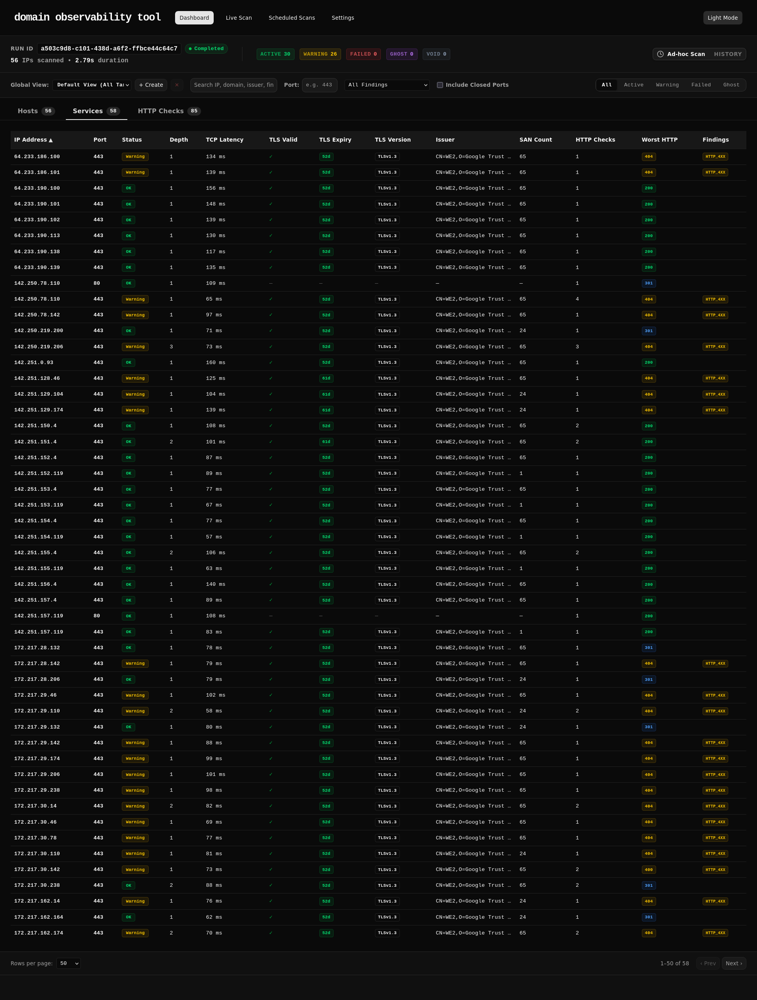
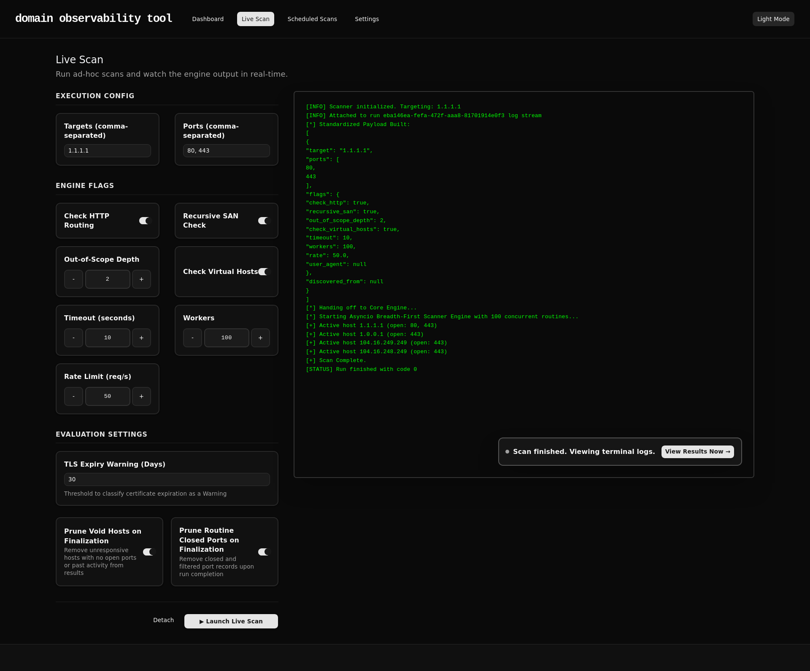
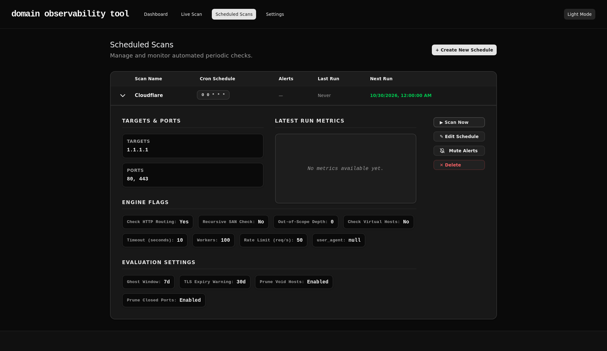

<div align="center">

# Site Health Check
*Monitoramento blackbox de rede e infraestrutura*

[Casos de Uso](#casos-de-uso) • [Especificações e Funcionamento](#especificações-e-funcionamento) • [Variáveis de Ambiente](#variáveis-de-ambiente) • [Instalação](#instalação) • [CI/CD](#cicd) • [Arquitetura](#arquitetura)

</div>

Ferramenta de varredura e monitoramento externo (blackbox) para verificar conectividade TCP, certificados TLS e respostas HTTP em sub-redes IPv4 e domínios. Composta por uma engine assíncrona de coleta, um dashboard web com API REST integrada e persistência agnóstica a bancos SQL (SQLite por padrão).

## Casos de Uso

1. Monitoramento contínuo de sub-redes e detecção de quedas (`GHOST`)
   Identificar servidores ou portas dentro de blocos CIDR (ex: `/24` até `/16`) que costumavam responder e pararam de responder entre uma execução e outra, diferenciando serviços que caíram de endereços IP que nunca estiveram em uso.

2. Controle de expiração TLS e descoberta de domínios via SAN
   Acompanhar validade e versão de certificados X.509 na rede e extrair recursivamente os Subject Alternative Names (SANs) encontrados nos certificados para descobrir outros domínios hospedados na mesma infraestrutura.

3. Auditoria de portas e roteamento HTTP de primeiro salto
   Verificar quais portas estão abertas em determinados blocos de IP ou hosts, inspecionando o código de status HTTP inicial, cabeçalhos do servidor e destino de redirecionamento (`Location`) sem seguir cadeias externas.

4. Notificações automáticas por gatilhos (Triggers) via Webhook
   Receber alertas no Google Chat, Slack ou endpoints HTTP próprios apenas quando condições específicas ocorrerem (quedas Ghost, erros 5xx, certificados inválidos/expirando ou abortos de execução), com opção de silenciar notificações por agendamento durante janelas de manutenção.

5. Diagnóstico imediato vs. histórico isolado
   Executar varreduras avulsas (Live Scan) para testar regras de firewall ou novos serviços em tempo real, mantendo o histórico e os alertas de rotinas agendadas (Scheduled Scans) isolados.

## Especificações e Funcionamento

### 1. Classificação de Status, Findings e Detecção de Ghosts

Ao final de cada varredura, o avaliador analisa as portas, certificados e respostas HTTP de cada host e atribui códigos de diagnóstico (Finding Codes) e um status consolidado:

| Status | Critério de Classificação | Findings Associados |
|---|---|---|
| `ACTIVE` (`ok`) | Pelo menos uma porta aberta sem erros ou avisos nos cheques TLS e HTTP. | Nenhum |
| `WARNING` | Pelo menos uma porta aberta, mas com aviso HTTP/TLS ou com alguma porta secundária que entrou em estado Ghost. | `HTTP_4XX`, `TLS_EXPIRING_SOON` (`<= tls_warning_days`), `TLS_DEPRECATED_VERSION` (`< TLSv1.2`) |
| `FAILED` | Pelo menos uma porta aberta apresentou falha de certificado ou erro de servidor HTTP. | `HTTP_5XX`, `HTTP_ERROR`, `TLS_INVALID`, `TLS_EXPIRED` (`<= 0d`) |
| `GHOST` | Nenhuma porta respondeu na execução atual, mas o endereço IP teve status `ACTIVE` em alguma execução anterior do mesmo agendamento dentro da janela `ghost_window` (padrão: `7d`). | `HOST_GHOST`, `TCP_CLOSED` |
| `VOID` | Nenhuma porta respondeu na execução atual e o endereço IP não possui histórico `ACTIVE` dentro da `ghost_window`. | `HOST_VOID`, `TCP_CLOSED` |

A busca histórica para classificação de `GHOST` é filtrada pelo identificador do agendamento (`scan_id`). Varreduras agendadas pelo Cron e execuções manuais disparadas pelo botão Scan Now de um agendamento existente avaliam e alimentam o histórico daquele `scan_id`. Varreduras avulsas iniciadas na tela Live Scan (`scan_id = null`) não avaliam Ghosts e não alteram a linha de base dos agendamentos.

### 2. Gatilhos (Triggers) e Notificações via Webhook

Cada agendamento possui configuração independente de alertas (`AlertConfig`). Ao término de uma execução agendada, o serviço de alertas verifica os gatilhos habilitados:

| Gatilho | Condição de Disparo |
|---|---|
| `alert_on_failure` | Quantidade de hosts com status `FAILED` maior que zero. Inclui no alerta os códigos de diagnóstico encontrados (`Findings`). |
| `alert_on_ghost` | Quantidade de hosts com status `GHOST` maior que zero. |
| `alert_on_warning` | Quantidade de hosts com status `WARNING` maior que zero. Inclui os códigos de diagnóstico encontrados (`Findings`). |
| `alert_on_abort` | Execução terminou com status `FAILED` ou `ABORTED`. |
| `alert_on_void` | Quantidade de hosts com status `VOID` maior que zero. |
| `notify_on_healthy` | Dispara confirmação mesmo quando nenhum gatilho de falha ou Ghost foi acionado (`failed == 0` e `ghost == 0`). |

O formato do payload enviado no POST para a `webhook_url` (timeout de 5s) é selecionado automaticamente conforme o destino:
1. Google Chat (`chat.googleapis.com`): envia estrutura `cardsV2` contendo status, identificação da run, gatilhos acionados, resumo numérico (`Active | Warning | Failed | Ghost | Void`), lista de `Findings` e botões com link direto para a tabela filtrada da execução (`/?run=<id>`) e para a página de agendamentos (`/scheduled-runs`).
2. Slack (`hooks.slack.com`): envia estrutura em Slack Block Kit com as mesmas informações e botões de navegação.
3. Webhook HTTP genérico: envia JSON contendo `text`, `schedule_name`, `run_id`, `triggers`, `summary`, `findings`, `table_url` e `is_healthy`.

O botão Mute Alerts (Alert Stopper) na página de agendamentos alterna o estado `alerts_muted` do agendamento. Quando ativado ou desativado, um aviso de mudança de estado é enviado ao webhook configurado, e as execuções seguintes do agendamento continuam sendo coletadas sem disparar notificações até que o alerta seja reativado. A conectividade do webhook também pode ser testada previamente via `POST /api/alerts/test`.

### 3. Coleta de Rede, TLS e HTTP

Os alvos podem ser informados como blocos CIDR IPv4 (ex: `143.106.16.128/26`, `10.0.0.0/16`), IPs individuais, nomes de domínio (FQDN), URLs ou combinados a portas específicas (`host:porta`).

Para cada porta configurada, a engine realiza uma conexão TCP assíncrona. Quando há handshake TLS, são extraídos Subject, Issuer, versão do protocolo TLS, data de expiração e a lista de SANs. Se a opção Recursive SAN Check estiver ativa na varredura, os domínios encontrados no certificado são adicionados à fila de execução da mesma varredura (respeitando a profundidade `out_of_scope_depth`).

Nas verificações HTTP/HTTPS, a requisição é feita sem seguir redirecionamentos automáticos (`follow_redirects=False`), registrando o status code exato do primeiro salto, a latência em milissegundos e a URL de redirecionamento.

### 4. Concorrência e Limites de Sistema Operacional

A engine utiliza `asyncio` com fila limitada para não expandir todos os IPs de uma sub-rede `/16` simultaneamente em memória.

Na inicialização, o processo consulta o limite de descritores de arquivo do sistema operacional (`RLIMIT_NOFILE`) e tenta elevar o soft limit até o hard limit disponível (teto de `65535`). Caso o sistema restrinja o número de arquivos abertos (como o limite padrão de `1024` em distribuições Linux sem ajuste de `ulimit`), o número de workers concorrentes é reduzido automaticamente para `max(50, soft_limit - 250)`, com retentativa e backoff em caso de erro `EMFILE`/`ENFILE` (`Errno 24`).

### 5. Persistência, Poda (Pruning) e Retenção

Em varreduras grandes, hosts sem nenhuma porta aberta (`prune_void_hosts`) e portas fechadas (`prune_closed_ports`) podem ser descartados antes da gravação no banco para evitar que uma sub-rede `/16` gere dezenas de milhares de registros inativos por execução.

A retenção automática (`retention_days`) é configurável em `/settings` (padrão `0`, mantendo o histórico indefinidamente). Quando definida com um valor maior que zero, o agendador apaga em segundo plano as execuções concluídas, abortadas ou falhas mais antigas que o limite de dias.

Execuções também podem ser apagadas individualmente no histórico ou em lote (Purge History). O último horário de disparo do agendamento fica registrado no próprio schedule (`last_triggered_at`), garantindo que apagar a última execução do histórico não faça o Cron disparar novamente na sequência.

Na subida da aplicação, a API compara as tabelas definidas nos modelos com o banco existente via `sqlalchemy.inspect` e adiciona colunas novas automaticamente, interrompendo a inicialização caso encontre incompatibilidade estrutural. A página `/settings` também permite recriar todas as tabelas do zero (Factory Reset).

## Variáveis de Ambiente

Configuradas via arquivo `.env` na raiz do projeto (baseado em `.env.template`).

### Aplicação e Banco de Dados

| Variável | Padrão | Descrição |
|---|---|---|
| `DATABASE_URL` | `sqlite:///site_health_check.db` | String de conexão SQLAlchemy. No Docker Compose, aponta para `sqlite:////data/site.db`. |
| `TIMEZONE` / `TZ` | `UTC` | Fuso horário para cálculo das expressões Cron e registros de data (ex: `America/Sao_Paulo`). |
| `DOMAIN_NAME` | `localhost` | Domínio ou IP usado na montagem de URLs externas enviadas nos payloads de alerta. |
| `HTTP_PORT` | `80` (`.env.template`: `8080`) | Porta HTTP exposta pelo container frontend. |
| `HTTPS_PORT` | `443` (`.env.template`: `8443`) | Porta HTTPS exposta pelo container frontend. |

### Proxy Nginx, SSL e CI/CD

| Variável | Scope CI/CD | Obrigatória no CI | Descrição |
|---|---|---|---|
| `ENABLE_SSL` | Per-environment | Sim | `true` para habilitar HTTPS com Let's Encrypt no container frontend. |
| `CERTBOT_EMAIL` | Per-environment | Sim | E-mail de registro no Let's Encrypt. |
| `LOCAL_HTTPS` | `local-staging` | Não | `true` para gerar certificado local auto-assinado (ignora Let's Encrypt). |
| `USE_STAGING_SSL` | Per-environment | Não | `true` para usar o ambiente de testes do Let's Encrypt. |
| `ALLOWED_IPS` | Per-environment | Não | Diretivas Nginx de controle de acesso por IP (ex: `allow all;` ou `allow 10.0.0.1;`). |
| `LOCAL_CA_DIR` | `local-staging` | Não | Caminho absoluto da CA local no host do runner (ex: `/home/gitlab-runner/.local-ca`). |

## Capturas de Tela

Dashboard  
Tabela de resultados com filtros por status, portas, certificados, códigos de diagnóstico (Findings) e histórico de execuções.  


Live Scan  
Formulário para disparo de varreduras avulsas e acompanhamento do log de execução em tempo real.  


Scheduled Scans  
Gerenciamento de rotinas Cron, parâmetros de avaliação e silenciamento de alertas (Mute Alerts).  


## Avisos de Uso

> [!WARNING]
> Esta ferramenta realiza apenas testes externos de rede, transporte e cabeçalhos HTTP/TLS. Não substitui monitoramento interno de recursos de sistema ou APM.

> [!CAUTION]
> Varreduras com alta frequência ou em blocos CIDR extensos podem ser bloqueadas por firewalls, IDS/IPS ou políticas de rate limit da rede de destino.

## Instalação

Pré-requisitos: Docker ou Podman com Compose.

1. Copie o template de variáveis de ambiente:
   ```bash
   cp .env.template .env
   ```
2. Suba os containers:
   ```bash
   docker compose up --build -d
   ```
3. Endpoints padrão:
   - Dashboard Web: `http://localhost:8080`
   - Documentação OpenAPI: `http://localhost:8000/docs`

## CI/CD

O pipeline do GitLab CI/CD executa um único estágio (`deploy`):

| Job | Branch trigger | Environment | O que faz |
|---|---|---|---|
| `deploy_local_staging` | `local-staging` | `local-staging` | Deploy no servidor de staging local |
| `deploy_production` | `production` | `production` | Deploy no servidor de produção |

Cada job gera o `.env` a partir das variáveis do GitLab, executa `init-letsencrypt.sh`, reconstrói os containers com `docker compose up -d --build` e remove imagens antigas com `docker system prune`.

Requisitos do runner (`tcp-scanner`, executor `shell`): Podman com alias `docker`, `podman-compose`, SubUID/SubGID configurados e `loginctl enable-linger` habilitado.

## Arquitetura

1. `engine/`: Pacote Python independente que executa a resolução de alvos e as sondas TCP, TLS e HTTP.
2. `api/`: Aplicação FastAPI que gerencia o agendador Cron, executa a engine via subprocesso/stream, avalia os resultados, dispara notificações via webhook e gerencia o banco de dados via SQLModel/SQLAlchemy.
3. `frontend/`: Aplicação React servida via Nginx que consome a API REST e os streams SSE.

Para desenvolvimento e execução da suíte de testes localmente com [uv](https://docs.astral.sh/uv/) e Node.js:
```bash
# Backend e Engine
uv sync
uv run pytest

# Frontend
cd frontend
npm install
npm test
```
