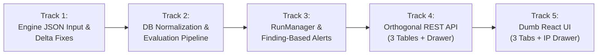

# ADR 0023: Control-Plane Modernization, Evaluation Pipeline & Flat Relational Explorer

Date: 2026-10-20  
Status: Accepted  
Supersedes: [ADR 0009](./0009-unified-target-merging.md), [ADR 0011](./0011-tree-dynamic-compression-and-filtering.md), [ADR 0012](./0012-reactive-visual-tree-compression.md), [ADR 0014](./0014-canonical-hierarchical-tree-table.md)  
Amends: [ADR 0016](./0016-execution-config-schema-sync.md), [ADR 0017](./0017-engine-streaming-output-contract.md)

---

## 1. Executive Summary

This ADR defines the architectural modernization of Site Health Check across the Engine seam, SQLite persistence layer, Backend Evaluation Pipeline, REST API, and React Frontend.

It establishes five core principles:
1. **JSON-over-stdin Configuration (`--config -`):** Programmatic scan invocation passes a single JSON configuration object over `stdin` using a shared schema, eliminating CLI flag-translation loops.
2. **Strict IP vs. Virtual-Host (Domain) Separation:** An IP address (`Host`) is a Layer-3 network node; domain names live at the Layer-7 `HttpRoutingCheck` (VHost) grain and as a deduplicated `resolved_domains` set on the IP detail view.
3. **Deterministic Backend Evaluation Pipeline:** Status evaluation (`ok`, `warning`, `failed`, `ghost`), worst/best rollups, and canonical **Finding Codes** are computed once on the backend before persistence—never re-derived in React or duplicated across alert scripts.
4. **Orthogonal, Dedicated Table Endpoints + On-Demand Drawer:** Each of the three flat tables (**Hosts**, **Services**, **HTTP Checks**) is served by its own dedicated, SQL-sorted/paginated endpoint returning flat row DTOs. Clicking the leftmost **IP** column in any table triggers an independent `GET /api/runs/{id}/hosts/{ip}` request to populate the detail drawer.
5. **Retirement of Dead Abstractions:** Drops unused `TargetGroup` join tables, `"Void..."` sentinel strings, `@model_serializer` ORM hacks, state-mutating `GET` endpoints, and the client-side `HierarchicalTable`.

---

## 2. Investigative Audit: Historical Intent vs. Codebase & Prototype Flaws

To ensure mistakes are not repeated during implementation, the following audit documents both the legacy codebase flaws and the specific anti-patterns found in `frontend/prototype-flat/flat-results.html`.

### A. Engine Delta Emission & Ingestion Bugs (Data Loss on VHosts & SANs)
1. **VHost HTTP Deltas Overwrite Open TCP Ports & Cause False Void Deletion (`engine.py:101` + `runner.py:61` + `runner.py:204`):**
   * *Empirical Evidence (`dns-google.raw.log` lines 29 & 36):* When scanning `dns.google` (`8.8.8.8`), Delta 1 records port `443` as `tcp_status="open", tcp_latency_ms=85` and discovers SAN `8888.google`. When `8888.google` resolves to the **same IP** (`8.8.8.8`), `skip_tcp` is `True` and `skip_http` is `False`.
   * However, `engine.py` initializes `local_state.ports[443] = PortState()` (which defaults to `tcp_status="closed", tcp_latency_ms=None, tls_certificate=None`) and emits that in Delta 2 alongside the `8888.google` HTTP check.
   * `runner.py:_upsert_delta_sync()` then executes `ON CONFLICT (host_state_id, port_number) DO UPDATE SET tcp_status='closed', tcp_latency_ms=NULL`, **overwriting the open port back to `"closed"`** (and overwriting `subrun_id="dns.google"` with `None`).
   * Worse: when `_finalize_run()` runs at the end of the scan, it checks `has_open = any(p.tcp_status == "open" for p in host.ports)`. Because port 443 was overwritten to `"closed"`, `has_open` is `False`—so **`_finalize_run()` classifies the active host `8.8.8.8` as a dead Void host and deletes it (and all its certificates and HTTP checks) from SQLite!**
2. **Engine Runs HTTP Probes on Closed TCP Ports (`engine.py:108-140`):**
   * *Empirical Evidence (`dns-google.raw.log` line 29):* On `8.8.8.8:80`, `check_tcp_and_tls` returns `tcp_status="closed"`, yet `engine.py` proceeds to execute `check_http_routing` on port 80 anyway, waiting for a full HTTP timeout (`notes="HTTP Timeout"`) and polluting closed ports with bogus HTTP check records.
   * Additionally, because `seen_tcp` records all attempted `ip:port` pairs regardless of whether TCP was open or closed, subsequent vhost tasks on the same IP see `skip_tcp=True` and also attempt HTTP probes on closed ports.
3. **Engine Discards `discovered_from` on Domain SANs (`engine.py:116-120`):**
   * When queuing recursive SANs from a TLS certificate, `engine.py` executes `ipaddress.IPv4Address(san)` and sets `discovered_from = None` on `ValueError`. Because certificate SANs are domain names (not raw IPs), `metadata.discovered_from` was always emitted as `[]`.
   * *Self-Loop Hazard:* Simply setting `discovered_from = state_key` without a same-IP guard would cause an in-scope SAN (like `8888.google` resolving back to `8.8.8.8`) to append `"8.8.8.8"` to its own `discovered_from` list, corrupting depth inference (`depth` would increment for the seed IP). Therefore, `discovered_from` must only be appended when `task.context.discovered_from != ip_address` (cross-IP discovery).
4. **Runner Overwrites `resolved_from`, `discovered_from`, and `subrun_id` on Shared IPs (`runner.py:39-45`):**
   * `HostState` stores a single scalar `metadata_resolved_from` and overwrites `metadata_resolved_from`, `metadata_discovered_from_json`, and `subrun_id` on every conflict update instead of merging domains/lineage as sets and preserving non-null `subrun_id` values.

### B. Contradictory Status & Rollup Evaluation in Four Places
Status classification and worst/best rollups are currently implemented four separate times with incompatible rules:
1. **`alerts.py:compute_run_summary()`:** Checks `elif port.tcp_status == "error":` (dead code—engine only emits `"open"` or `"closed"`), classifies invalid/expired TLS certificates (`valid=False`) only as `warning` instead of `failed`, and uses substring matching (`"Failed" in http.notes`) to detect HTTP timeouts.
2. **`runner.py:_finalize_run()`:** Counts `anomalies_found` with a custom loop that ignores `expires_in_days <= tls_warning_days` and ignores HTTP checks where `status_code is None`.
3. **`frontend/src/features/scans/utils/buildTree.ts`:** Re-computes statuses in TypeScript with a hardcoded `< 30` day TLS warning threshold (ignoring the scan's `tls_warning_days`).
4. **`frontend/prototype-flat/flat-results.html` (Prototype Flaws):**
   * **Broken `worst` HTTP Rollup on Timeouts:** Line 3092 computes `const st = p.http.map(c => c.status).filter(x => x != null); worst: Math.max(...st)`. If a port has one vhost returning `200` and another vhost that timed out (`status: null`), `worst` evaluates to `200` (green `ok`), masking the failed vhost!
   * **Mismatched Notes Tooltip:** Line 3126 passes `r.http[0]?.notes` (the note of the *first* vhost) as the tooltip for `r.worst` (the highest status code across *all* vhosts).

### C. Prototype Payload & Structural Anti-Patterns (`flat-results.html`)
While `flat-results.html` validated the 3-tab + drawer visual layout, its internal data model contains four flaws that **must not** be copied into production:
1. **Monolithic Nested Array (`RAW`) Flattened in Browser RAM:** The prototype embeds a single deeply nested JSON tree containing all hosts, ports, HTTP checks, and 65-element TLS SAN arrays repeated across every Google IP (~3,000 lines), then runs `.flatMap()`, sorting, and pagination in JavaScript. In production, each table must be served by its own flat, paginated backend endpoint.
2. **Scraping `stderr` for "Skipped (Exceeds Max Depth)" Rows:** Lines 3003–3079 of `flat-results.html` inject unprobed, out-of-scope IPs (depth 3 > max 2) as fake rows in the `Hosts` table. Out-of-scope targets skipped by depth policy are not scanned hosts and must not clutter the `Hosts` table.
3. **Inline Hostname Crowding on Shared IPs:** Putting domain names in the `Hosts` table fails when an IP serves dozens of virtual hosts. Strict separation between Layer-3 **IPs** (`Hosts` table) and Layer-7 **Domains** (`HTTP Checks` table) is required.
4. **Client-Side Redirect IP Lookup (`byName` Map):** Line 3114 attempts to resolve redirect URLs (`→ https://www.google.com/`) to an IP via an in-memory map of all hosts in the scan, which breaks as soon as tables are paginated on the server.

### D. Dead Database Join Tables (`TargetGroup`) & Sentinel Strings (`"Void..."`)
1. **`TargetGroup` & `ScanTargetGroupLink`:** Originally intended for a standalone catalog of reusable target groups. That feature was never built or required; `/api/target-groups` is **not** missing functionality, it is an **abandoned concept**. Synthesizing hidden `"Ad-hoc Target Group"` rows on every scan save is pure dead weight.
2. **`"Void"` Sentinel Rows:** "Void Space" (`total_hosts - active_hosts - ghost_hosts`) is a summary metric, never a database entity or a literal `ip_address="Void (254)"` string.

---

## 3. Architectural Decisions (The Five Modernization Tracks)

### Track 1: Shared Schema, Engine JSON Input (`-c`) & Delta Fixes (`engine_json_contract`)
1. **Single Source of Truth for Flags (Zero-Breakage Compatibility):** Define `TaskFlags` (`ExecutionFlags = TaskFlags`) once in `engine/src/engine/schemas/engine.py` as a Pydantic `BaseModel` with canonical field names (`check_http`, `recursive_san`, `out_of_scope_depth`, `check_virtual_hosts`, `timeout`, `workers`, `rate`, `user_agent`), supporting `AliasChoices` and compatibility properties for legacy `timeout_seconds` / `recursive_san_check` callers. Import directly in `api/src/api/models.py`.
2. **Single-Object JSON Input (`--config <path|->`):** Add `-c` / `--config` to `engine/src/engine/cli.py`. It accepts **strictly one JSON object** (`{"targets": [...], "ports": [...], "flags": {...}}`) as an input formatting alternative to CLI flags (not a task splitter). `runner.py` invokes `python -u -m engine.cli --config -` over `stdin`, deleting the CLI flag-translation loop.
3. **Engine & Ingestor Delta Integrity Fixes (Zero Output Schema Change):**
   * **Track Open TCP Ports (`open_tcp`):** Maintain `open_tcp: set[str]` alongside `seen_tcp` in `engine.py`. Only execute `check_http_routing` when `tcp_cache_key in open_tcp`, preventing 10s HTTP timeouts on closed TCP ports. When `skip_tcp` is `True` for an open port, initialize `PortState(tcp_status="open")`.
   * **Cross-IP `discovered_from` Guard:** Always pass `discovered_from = state_key` when queuing SAN or redirect tasks, and append `task.context.discovered_from` to `local_state.metadata.discovered_from` **only when `task.context.discovered_from != ip_address`** (preventing self-loops when a vhost SAN resolves to the same IP, and allowing the backend to infer `depth` directly from `discovered_from`).
   * **Non-Destructive Upserts in `runner.py`:** Preserve `tcp_status="open"`, `COALESCE` `tcp_latency_ms` and `subrun_id`, and union `discovered_from` lists during `_upsert_delta_sync` so subsequent vhost deltas never erase prior probe state or trigger false Void deletion.

### Track 2: Database Normalization & Backend Evaluation Pipeline (`db_and_evaluation_pipeline`)
1. **Retire `TargetGroup` & Sentinel Strings:** Drop `TargetGroup` and `ScanTargetGroupLink`; store `targets: list[str]` directly on `Scan`. Remove all `ip_address.startswith("Void")` logic.
2. **Set-Union Domain & Lineage Storage on `HostState`:** Replace scalar `metadata_resolved_from` with `resolved_domains: list[str]` and `discovered_from: list[str]`, merged via set-union during batch ingestion so multiple vhosts on one IP never overwrite each other.
3. **Deterministic Backend Evaluation Pipeline (`api/services/evaluator.py`):**
   Compute status (`ok`, `warning`, `failed`, `ghost`), rollups, and canonical **Finding Codes** bottom-up before saving final state:
   * **Finding Codes:**
     * `TCP_CLOSED`
     * `TLS_INVALID`, `TLS_EXPIRED`, `TLS_EXPIRING_SOON`, `TLS_DEPRECATED_VERSION` (`< TLSv1.2`)
     * `HTTP_5XX`, `HTTP_4XX`, `HTTP_ERROR` (timeout / connection error where `status_code is None`)
     * `HOST_GHOST`, `HOST_VOID`, `RUN_ABORTED`
   * **Pre-Computed Columns on `HttpRoutingCheck`:** `status` (`ok | warning | failed`), `finding_code`.
   * **Pre-Computed Columns on `PortState` (Service):** `status` (`ok | warning | failed`), `san_count: int`, `http_check_count: int`, `worst_http_status: int | None`, `finding_codes: list[str]`. (Note: If any HTTP check has `HTTP_ERROR` / `status_code is None`, the service `status` is `failed`).
   * **Pre-Computed Columns on `HostState` (IP):** `status` (`ok | warning | failed | ghost`), `depth: int`, `open_port_count: int`, `scanned_port_count: int`, `vhost_count: int`, `min_tcp_latency_ms: int | None`, `min_tls_expires_days: int | None`, `worst_tls_version: str | None`, `worst_http_status: int | None`, `finding_codes: list[str]`.
4. **SQLite WAL & Batched Ingestion:** Enable `PRAGMA journal_mode=WAL;` and `PRAGMA foreign_keys=ON;`, add `UniqueConstraint("port_state_id")` on `TlsCertificate`, and batch NDJSON delta commits.

### Track 3: Encapsulated `RunManager` & Finding-Based Alert Matcher (`run_manager_and_alerts`)
1. **Typed `RunManager`:** Replace untyped `app.state` dicts (`processes`, `run_logs`, `log_subscribers`) with a `RunManager` service that manages subprocesses, SSE queues, and bounded/evicted log buffers.
2. **Unified Run & Alert Pipeline:** Every run (manual or scheduled) executes the same pipeline: `Ingest ➔ Finalize & Evaluate ➔ Match Alerts`.
3. **Finding-Driven Alert Matching:** Evaluate alert triggers directly against the run's aggregated `finding_codes` and `status` counts from Track 2's evaluator—enabling filtering by specific issue types or versions without writing custom database loops per trigger.

### Track 4: Orthogonal REST API for the 3 Tables & IP Drawer (`rest_api_orthogonality`)
1. **Single Run Launch Endpoint:** Merge `POST /api/runs/launch` and `POST /api/scans/{id}/launch` into `POST /api/runs`.
2. **Idempotent Alert Controls:** Remove `GET /api/scans/{id}/alerts/mute` and `/unmute` HTML endpoints; use `PATCH /api/scans/{id}` (`{"alerts_muted": bool}`).
3. **Dedicated Paginated Table Endpoints (Strict IP Leftmost Key):**
   All three table endpoints accept orthogonal query parameters (`ip`, `q`, `status`, `finding`, `sort_by`, `sort_dir`, `limit`, `offset`) executed in SQL and return `{ "items": [...], "total": int }`:
   * **`GET /api/runs/{id}/hosts` ➔ `Page[HostRowDTO]`:**
     Fields: `ip_address` (index), `status`, `depth`, `vhost_count`, `open_port_count`, `scanned_port_count`, `min_tcp_latency_ms`, `min_tls_expires_days`, `worst_tls_version`, `worst_http_status`, `finding_codes`. *(No inline domain lists or SAN arrays).*
   * **`GET /api/runs/{id}/services` ➔ `Page[ServiceRowDTO]`:**
     Fields: `ip_address` (index), `port`, `status`, `depth`, `tcp_latency_ms`, `tls_valid`, `tls_expires_in_days`, `tls_version`, `tls_issuer`, `san_count`, `http_check_count`, `worst_http_status`, `finding_codes`. *(Sends `san_count`, never the raw SAN array).*
   * **`GET /api/runs/{id}/checks` ➔ `Page[HttpCheckRowDTO]`:**
     Fields: `ip_address` (index), `port`, `domain` (the vhost), `status`, `status_code`, `http_latency_ms`, `redirects_to_url`, `server_header`, `notes`, `finding_code`.
4. **Dedicated On-Demand IP Drawer Endpoint:**
   * **`GET /api/runs/{id}/hosts/{ip}` ➔ `HostDetailDTO`:**
     Triggered only when the user clicks an `ip_address` in column 1 of any table. Returns the full details for that single IP: discovery lineage (`depth`, `root_target`, `resolved_domains`, `discovered_from`), all `services` on that IP, all `http_checks` on that IP, and the deduplicated `tls_sans` list.

### Track 5: Dumb React Flat Explorer (`frontend_flat_explorer`)
1. **Delete Legacy Tree Components:** Delete `HierarchicalTable`, `buildTree.ts`, `filterTree`, `sortTree`, and `RenderTreeNode`.
2. **Strict IP-Indexed 3-Tab Table + Drawer:**
   * Render **Hosts**, **Services**, and **HTTP Checks** tabs backed directly by the three paginated endpoints from Track 4.
   * **Visual Invariant:** `IP Address` is always the first (leftmost) column in every table and is the **only** clickable entity link.
   * Clicking an IP sets `?drawer=<ip>` in the URL and fetches `GET /api/runs/{id}/hosts/{ip}` to render the slide-over Drawer.
   * All sorting, filtering, and status badge colors come directly from the backend DTOs—zero status or rollup computation in React.

---

## 4. Explicit Deprecations & Retirements Checklist

| Artifact / Pattern | Location | Action | Replacement |
| :--- | :--- | :--- | :--- |
| `TargetGroup` & `ScanTargetGroupLink` | `api/src/api/models.py`, `scans.py` | **DELETE** | `Scan.targets: list[str]` |
| `json_schema_extra={"cli_arg": ...}` | `api/src/api/models.py` | **DELETE** | Shared schema in `engine.schemas` |
| CLI flag construction loop | `api/src/api/services/runner.py` | **DELETE** | `python -m engine.cli --config -` |
| `@model_serializer(mode="wrap")` | `api/src/api/models.py` | **DELETE** | Dedicated Table & Drawer DTOs |
| `ip_address.startswith("Void")` | `runner.py`, `aggregation.py`, `alerts.py` | **DELETE** | Pre-computed summary counter |
| 4 duplicate status/rollup loops | `runner.py`, `alerts.py`, `buildTree.ts` | **DELETE** | `api/services/evaluator.py` |
| `GET /api/scans/{id}/alerts/mute` | `api/src/api/routers/scans.py` | **DELETE** | `PATCH /api/scans/{id}` |
| `HierarchicalTable` & `buildTree.ts` | `frontend/src/features/scans/` | **DELETE** | 3-Tab Flat Explorer + On-Demand IP Drawer |
