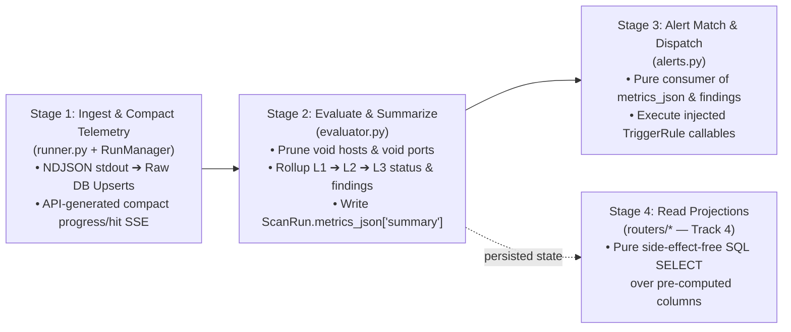

# Architectural Review & Pipeline Retrospective (`run_manager_and_alerts`)

Date: 2026-10-22  
Track: `run_manager_and_alerts` (Track 3 of [ADR 0023](../../adr/0023-control-plane-and-flat-explorer-modernization.md))  
Status: Approved Direction — Ready for Implementation

---

## 1. Executive Summary & Live-Network Verification Context

During the Conductor review of Track 3 (`run_manager_and_alerts`), we went beyond synthetic unit tests (`105 passed`) and executed live network verification against subnets in `143.106.0.0/16` paired with a local async Mock Webhook Receiver (capturing Google Chat Cards v2 and Slack Block Kit payloads):

1. **Small Sample (`143.106.1.0/28`, `143.106.7.32/28` — 32 IPs, ports `[80, 443]`, `workers=2000, buckets=1000`):**
   - Raw `engine.cli` and API `RunManager` discovered the exact same 3 responsive hosts (`143.106.7.37`, `143.106.7.44`, `143.106.7.47`) and 29 void hosts.
   - **Discrepancy Exposed:** `evaluator.py` classified the 3 hosts as `ok: 1, warning: 1, failed: 1`, whereas `run.metrics_json["summary"]` and the Google Chat webhook reported `Active: 2 | Warning: 0 | Failed: 1 | Void: 29`.
2. **Large Sample (`143.106.0.0/21`, `143.106.8.0/23` — 2,560 IPs, ports `[80, 443]`, `workers=3000, buckets=1500`):**
   - Scanned 2,560 IPs, pruned 2,506 void hosts, and retained 54 responsive hosts with canonical findings `['HTTP_4XX', 'HTTP_5XX', 'HTTP_ERROR', 'TCP_CLOSED', 'TLS_EXPIRING_SOON', 'TLS_INVALID']`.
   - **Discrepancy Exposed:** `evaluator.py` classified the 54 hosts as `ok: 29, warning: 6, failed: 19`, whereas `run.metrics_json["summary"]` and the Slack webhook reported `Active: 34 | Warning: 5 | Failed: 15 | Void: 2506`.
   - **Stream Saturation Exposed:** `RunManager` emitted ~1,500 `WARNING: Subscriber queue full for run ...; dropping event for slow consumer` messages during the 2,560-IP burst.

Investigating these discrepancies from first principles revealed that the initial implementation had tangled responsibilities across `run_manager.py`, `runner.py`, `evaluator.py`, and `alerts.py`.

---

## 2. What We Fought Against (Root Causes & Architectural Anti-Patterns)

### 2.1 Circular Cross-Stage Coupling (`runner ➔ alerts ➔ runner ➔ evaluator`)
- **The Problem:** During finalization in `runner.py:_finalize_run()`, execution called `evaluator.evaluate_scan_run(run_id, session)` (line 268), and then called `alerts.compute_run_summary()` (line 283) **before** `run.metrics_json` was assigned (line 291). Afterward, `RunManager._execute_run()` called `evaluate_scan_run()` a **second time** synchronously on the event loop.
- **Why It Was Wrong:** The scan runner depended on the alerting service (`alerts.py`) to compute core run metrics, and evaluation ran twice per scan.

### 2.2 Retaining the Legacy Port/Certificate Loop Behind a Guard in `alerts.py`
- **The Problem:** In Phase 3, `compute_run_summary()` in `alerts.py` added an early return (`if run.metrics_json and "summary" in run.metrics_json: return ...`) at the top of the function, but kept the 100-line pre-Track-2 nested `HostState -> PortState -> TlsCertificate -> HttpRoutingCheck` loop underneath it.
- **Why It Failed on Every Scan:** Because `_finalize_run()` called `compute_run_summary()` *in order to build* `run.metrics_json`, `run.metrics_json` was always `None` at that moment. Execution fell through to the legacy loop, which used outdated rules (marking HTTP `400..499` as `failed` instead of `warning`, and `TLS_INVALID` as `warning` instead of `failed`) and wrote those contradicting numbers into `run.metrics_json["summary"]`.

### 2.3 Treating Void (Never-Open) Ports on Active Hosts as Service Failures
- **The Problem:** When scanning multiple ports (e.g., `[80, 443]`), a healthy single-port server (such as `143.106.7.44` with Port 80 open `302` and Port 443 not listening) had a `PortState(443, tcp_status="closed")` row stored in SQLite. `evaluator.py` marked every closed port as `port.status = "failed"` (`TCP_CLOSED`) and rolled `any(p.status == "failed" for p in host.ports)` up to `host.status = "failed"`.
- **Why It Was Wrong:** If a port is not listening, it is either **void** (never historically open) or a **ghost** (historically open within `ghost_window`, now dark). Marking void ports as service failures causes any web server that does not listen on *every* probed port in the scan list to be flagged as a failed host.

### 2.4 Per-IP Worker Log Firehose (`Engine ➔ API ➔ Client`)
- **The Problem:** `engine/src/engine/engine.py` logged `logger.info(f"[Routine {routine_id}] Processing {target}...")` to `stderr` for every single IP pulled from the queue—even when 98% of IPs in a CIDR block are empty voids. Under 3,000 concurrent workers, thousands of lines arrived in a single OS pipe buffer read, instantly overflowing `RunManager`'s `asyncio.Queue(maxsize=100)` subscriber queues and risking dropping the `None` EOF termination sentinel.

---

## 3. What Was Suggested & Repelled (Rejected Band-Aids & Over-Engineering)

| Proposal | Why It Was Repelled |
| :--- | :--- |
| **1. Chaining `if` conditions in `evaluate_alert_triggers()`** | Violates the Open-Closed Principle and makes adding or testing custom team alert triggers brittle. Replaced with the **Callable Rule Strategy Pattern** (`TriggerContext` + injected `TriggerRule` functions). |
| **2. Patching `alerts.compute_run_summary()` to run a fallback `GROUP BY` SQL query and lazily invoke `evaluate_scan_run()`** | **Contouring the problem.** Core alerting (`alerts.py`) should not compute or repair database summaries at all; `evaluator.py` must produce the summary during the Evaluation stage, and `alerts.py` must be a pure consumer. |
| **3. Lazy Summary Calculation & DB Commits inside `GET /api/results/summary` and `GET /api/runs/{id}/results`** | Violates REST orthogonality (Track 4 of ADR 0023). `GET` endpoints must be side-effect-free read projections over pre-computed data, never mutating `ScanRun` rows on read. |
| **4. Low-level `asyncio.StreamReader` yield tricks to stream 65,536 raw `"Processing <IP>..."` worker lines to the browser** | **Over-engineering.** An SRE watching the live terminal does not need a 65,536-line scrollback of void IPs. They need a compact, high-signal view of current pipeline progress and active discoveries. |

---

## 4. What We Found to Follow (The Canonical 4-Stage Orthogonal Pipeline)

To maintain strict alignment with [ADR 0023](../../adr/0023-control-plane-and-flat-explorer-modernization.md) and clean pipeline engineering, execution flows unidirectionally through four isolated stages:

### 4.1 Stage 1: Ingestion & Compact API-Generated Progress Stream (`runner.py` & `run_manager.py`)
1. **Engine `stderr` Hygiene (`engine/src/engine/engine.py`):**
   - Demote per-IP `[Routine Worker-X] Processing <IP>...` trace logs from `logger.info` to `logger.debug`. `stderr` at `INFO` level only emits high-level engine lifecycle events (startup, signal abort, completion) and errors.
2. **Compact API Progress Stream (`runner.py` $\to$ `RunManager.publish_log`):**
   - As `_ingest_stdout()` ingests NDJSON records from the engine, the API generates concise, high-signal terminal events for the SRE:
     - **Active Host Discovery:** Logged immediately when an IP reports open port(s) (e.g., `[+] Active host 143.106.7.37 (open: 80, 443)`).
     - **Periodic Progress Heartbeat:** Logged every $N$ probed IPs (e.g., every 250 IPs: `[~] Progress: 500 IPs probed (12 responsive)...`).
     - **Stage Transitions:** Logged when entering finalization/evaluation and upon completion with summary counts.
3. **Sliding-Window Ring Buffer (`RunManager`):**
   - Keep a compact history buffer (`maxlen=250`) and sliding-window subscriber queues: if a subscriber queue is full, evict the oldest queued item (`q.get_nowait()`) before inserting the new event (without warning spam), and **never** drop the `None` EOF sentinel in `broadcast_sentinel()`.

### 4.2 Stage 2: Deterministic Evaluation & Summary Ownership (`evaluator.py`)
1. **Single Owner of Finalization & Summary:**
   - `evaluate_scan_run(run_id, session)` in `api/src/api/services/evaluator.py` (invoked once during finalization) is the **sole place** that computes `HostState.status`, `PortState.status`, `finding_codes`, and `ScanRun.metrics_json["summary"]`.
   - Remove the duplicate `evaluate_scan_run()` call from `RunManager._execute_run()`, and remove the `alerts.compute_run_summary()` call from `runner.py:_finalize_run()`.
2. **Void vs. Ghost Port Semantics on Active Hosts:**
   - If a port is not listening (`tcp_status != "open"`), it is either **void** (never historically open) or a **ghost** (historically open within `ghost_window`).
   - During finalization/evaluation, non-listening ports that were never historically open on that IP:port are **void** and must not mark an active host (`open_port_count > 0`) as `failed`.
   - If a specific port on an active host *was* historically open within `ghost_window` and is now closed, it triggers a ghost warning (`HOST_GHOST` / `warning` status) so the SRE is alerted that a previously active service went dark.

### 4.3 Stage 3: Pure Strategy-Driven Alerting (`alerts.py`)
1. **Zero Direct Port/Cert Iteration in Core Alerts:**
   - Delete the 100-line legacy `HostState -> PortState -> TlsCertificate -> HttpRoutingCheck` loop from `alerts.py:compute_run_summary()`.
   - `compute_run_summary()` simply returns `run.metrics_json["summary"]` (with a lightweight `SELECT status, COUNT(*) FROM hoststate GROUP BY status` fallback only for unfinalized test fixtures).
2. **Injected `TriggerRule` Strategy Pattern:**
   - Core triggers (`DEFAULT_TRIGGER_RULES`) operate strictly on `TriggerContext(alert_config, run_status, summary_stats, finding_codes)`.
   - Custom team add-on rules can be injected into `evaluate_alert_triggers(..., rules=[...])`.

### 4.4 Stage 4: Orthogonal Read Projections (`routers/`)
- `GET` endpoints (`runs.py`, `results.py`, and Track 4's flat table endpoints) read directly from `run.metrics_json` and pre-computed `HostState`/`PortState`/`HttpRoutingCheck` columns without mutating database state on read.
